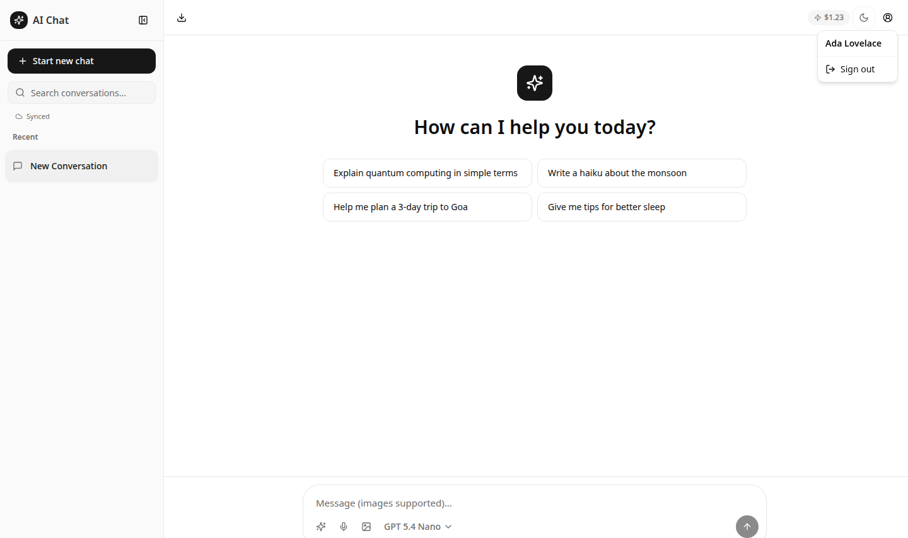
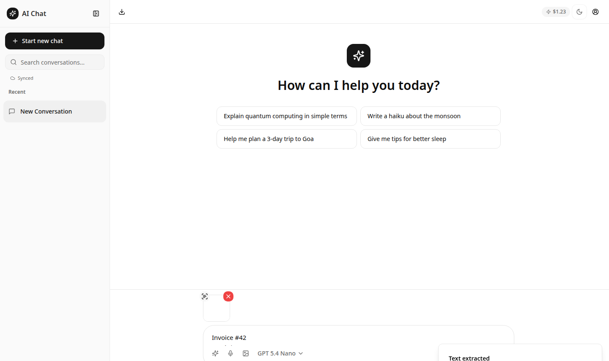

# AI Chat — Multi-Model Assistant

A modern chat application that puts hundreds of AI models behind one clean interface. Sign in once — no API keys to manage — and every model call is covered by your account credits.

   

---

## Features

### Chat
- **Live model catalog** — providers and models are fetched from the backend at startup and grouped by provider (OpenAI, Claude, Mistral, Grok, OpenRouter, …). The catalog is never hardcoded, so new models appear automatically.
- **Streaming responses** with a stop button, message regeneration, and per-message copy / delete.
- **Rich rendering** — markdown, fenced code blocks, and inline images are formatted in chat bubbles.
- **Conversation management** — sidebar with search, rename-on-first-message, two-step delete, and export to Markdown or JSON.

### Multimodal
- **Image attachments** — attach up to 4 images (auto-converted to PNG when needed) and send them to any vision-capable model. Vision support is detected from each model's live capability data.
- **Image generation** — an inline "generate image" prompt; results render directly in the conversation.
- **OCR** — hover an attached image and hit the scan button to extract its text straight into the composer.

### Voice
- **Voice input** — hold the mic button to dictate; speech is transcribed and inserted for review before sending.
- **Read aloud** — every assistant message has a Read aloud / Stop action. Markdown is converted to speakable text (code blocks become "[code omitted]"), long messages are capped at the speech API's 3,000-character limit, and only one message speaks at a time.

### Cross-device sync
Conversations sync across your devices through secure cloud storage:

- One JSON document per user holds all conversations plus delete tombstones.
- **Per-conversation last-writer-wins** on an `updatedAt` timestamp — editing different chats on two devices never clobbers either.
- **Tombstones** (30-day retention) keep a delete on one device from being resurrected by another.
- Sync runs on sign-in, when the tab regains focus, and debounced 2 seconds after local changes.
- The sidebar shows live status: `Local only`, `Syncing…`, `Synced`, `Sync failed`.
- Fully offline-first: sync failures never break local use, and everything works signed out exactly as before.

### Account
- **Sign-in** via popup; auth state re-checks on mount and tab focus.
- **Profile menu** — avatar and display name in the header, with sign-out.
- **Credit pill** — remaining monthly credit shown in the header, turning amber under 10% of allowance.





---

## Getting started

### Prerequisites
- Node.js 18+ and npm (or [bun](https://bun.sh))
- A free account — sign-in happens in the app; no API keys needed

### Install & run
```bash
npm install
npm run dev        # → http://localhost:8080
```

### Build for production
```bash
npm run build      # outputs to dist/
npm run preview    # serve the production build locally
```

### Lint
```bash
npm run lint
```

### Tests
```bash
bun test         # 82 unit tests in tests/ (bun's test runner)
```

The suite covers the pure library modules with a mocked `puter` SDK and an
in-memory `localStorage` shim (`tests/helpers.ts`): sync merge/tombstones/
push behavior (`sync.test.ts`), markdown-to-speech and the TTS char limit
(`tts.test.ts`), image generation + transcription (`media.test.ts`), the live
model catalog (`models.test.ts`), credits/profile/OCR (`account.test.ts`),
and Drive saves (`drive.test.ts`).

---

## Usage

1. **Sign in** — click *Sign in* on the welcome screen (popup).
2. **Pick a model** — the selector groups live models by provider; vision models accept image attachments.
3. **Chat** — type, dictate with the mic, or attach images. Use the image button in the composer to generate images instead of chatting.
4. **Sync** — once signed in, conversations sync automatically. Watch the status line in the sidebar.
5. **Export** — the download menu in the header exports the active conversation as Markdown or JSON.

---

## Project structure

```
src/
├── components/
│   ├── ChatInput.tsx          # Composer: text, mic, image attach, OCR, image-gen prompt
│   ├── ChatMessage.tsx        # Message bubble: markdown rendering, read-aloud, copy/delete
│   ├── ConversationSidebar.tsx# Search, list, delete, sync status
│   ├── ModelSelector.tsx      # Provider-grouped model picker from the live catalog
│   ├── CreditPill.tsx         # Remaining credit indicator
│   ├── AuthButton.tsx         # Sign-in flow
│   └── ui/                    # shadcn/ui primitives (button, dropdown, toast, …)
├── lib/
│   ├── backend.ts             # Typed cloud SDK surface (ai, auth, storage)
│   ├── models.ts              # Live catalog: providers, vision detection, grouping
│   ├── sync.ts                # Cloud sync: merge, tombstones, TTL
│   ├── tts.ts                 # Text-to-speech + markdown-to-speech conversion
│   ├── speech.ts              # Speech-to-text (voice input)
│   ├── images.ts              # Text-to-image generation
│   ├── ocr.ts                 # Image-to-text (OCR) with friendly errors
│   ├── usage.ts               # Credit balance from the usage API
│   ├── profile.ts             # Avatar/display name from the profile API
│   └── utils/
│       ├── export.ts          # Markdown/JSON export
│       ├── storage.ts         # localStorage persistence
│       └── imageConversion.ts # Image → PNG normalization
├── pages/
│   └── Index.tsx              # App shell: auth, conversations, streaming, sync orchestration
└── hooks/use-toast.ts         # Toast notifications
```

---

## How sync works

`src/lib/sync.ts` is the entire sync engine (~200 lines):

| Concept | Detail |
|---|---|
| Storage | One cloud document per user, holding conversations + tombstones |
| Local cache | `localStorage` — the app works fully offline |
| Conflict resolution | Per-conversation last-writer-wins via `updatedAt` |
| Deletes | Tombstones (`{ conversationId: deletedAt }`), 30-day TTL |
| Triggers | Sign-in, tab focus / visibility change, debounced 2 s after edits |
| Failure mode | Sync errors are swallowed; status shows `Sync failed`, local use unaffected |

`updatedAt` is stamped automatically by a wrapper around the conversation state setter, so call sites don't need to think about it.

---

## Tech stack

- **React 18 + TypeScript + Vite** — app framework and build
- **TailwindCSS + shadcn/ui + lucide-react** — styling, components, icons
- **Managed cloud backend** — auth, AI models, text-to-speech, speech-to-text, image generation, OCR, and key-value storage behind a single typed SDK
- Dark/light mode; responsive sidebar (overlay on mobile, fixed on desktop)

---

## Notes

- All AI calls are billed against the signed-in user's account credits. The credit pill shows what's left.
- Real backend calls require interactive sign-in; the app degrades gracefully when signed out or offline.
