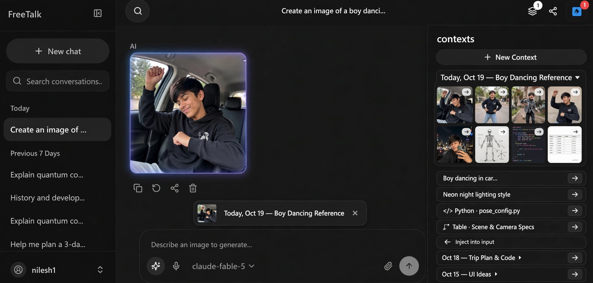

# Explicit Context Selection & Contexts Panel — Technical Spec

**Status:** implemented and verified (2026-10-19) · **Owner branch:** `arena/37096a7b-chat-puter-vision`
**Supersedes:** automatic last-image lock in [`image-edit-context-spec.md`](image-edit-context-spec.md) (§5.1–§5.2, §7.3)
**Builds on:** [`image-artifacts-panel-spec.md`](image-artifacts-panel-spec.md) · [`artifacts-phase-3-spec.md`](artifacts-phase-3-spec.md)
**UI References:** [`screenshots/context-panel-final.png`](screenshots/context-panel-final.png) · [`screenshots/context-panel-multi-item.png`](screenshots/context-panel-multi-item.png) · [`screenshots/context-panel-mockup.png`](screenshots/context-panel-mockup.png)



---

## 1. Problem

[`image-edit-context-spec.md`](image-edit-context-spec.md) fixed the bug where
image-generation mode (`✨`) ignored attachments, by introducing
`findCurrentImage(messages)` and automatically chaining every image-generation
turn to the newest image in the open conversation.

In practice, that automatic rule creates three new problems:

1. **You cannot generate a brand-new image in a chat that already has an image.**
   As soon as a conversation contains one generated or attached picture, toggling
   `✨` locks the composer onto *"Editing the last image in this chat."* There is
   no `×` button to dismiss it. Asking for an unrelated image silently passes the
   previous image as `input_image` to `puter.ai.txt2img`.
2. **You can only ever reference the *last* image — never up to 10 images, earlier
   messages, code blocks, or tables together.**
   If you want to combine multiple images with text notes, a Python script, and a
   Markdown table in one reusable reference bundle, nothing in the UI lets you
   collect those pieces into a single context.
3. **Context is trapped inside one modality and loses its source location.**
   `findCurrentImage` only serves `handleGenerateImage`. It cannot feed a saved
   reference group into a normal chat/vision turn (`handleSendMessage`), and once
   content is copied into a prompt, there is no way to click an item to jump back
   to and highlight where it came from in the chat.

---

## 2. Goals

1. **Remove the forced *"Editing the last image in this chat."* lock.**
   When no context group and no manual attachment is active in the composer,
   image-generation mode (`✨`) performs plain text-to-image from scratch.
2. **Add a dedicated Contexts toggle in the header**, immediately adjacent to the
   Artifacts (`Layers`) button, opening a right-hand **Contexts Panel**.
3. **Collapsible, date-named Context Groups holding up to 10 images + multiple
   texts, code blocks, tables, and artifacts.**
   - Collapsed Context Groups show only their single-line date-stamped title row
     (e.g. `"Oct 18 — Trip Plan & Code ▸"`) and a quick inject button.
   - Clicking a Context Group expands it (`▾`) to show its full contents: up to
     **10 image thumbnails** in a compact grid plus **multiple text snippets,
     code blocks (`</> Python · pose_config.py`), and tables (`▦ Table · Scene & Camera Specs`)**.
4. **Source provenance & right-arrow (`→`) jump-and-highlight on EVERY item.**
   Every text row, code block row, table row, and image thumbnail inside a Context
   Group has a right-pointing arrow **`→`** button (*"Show in chat"*). Clicking
   `→` scrolls the transcript to the exact message, image, code block, table, or
   text range where that item came from and highlights it with a glowing outline
   (`data-artifact-flash` + CSS Custom Highlight API for text snippets).
5. **One-click `← Inject into input` action.**
   Clicking **`← Inject into input`** on any Context Group injects it into the
   composer as a **dismissible Context Pill** (thumbnail + title + `×` button)
   above the prompt box.
6. **Task-agnostic execution.**
   - In **Chat mode**, an injected Context Group sends its text/code/table items
     as structured prompt context and its images as `image_url` blocks.
   - In **Image Generation mode (`✨`)**, an injected Context Group sends its
     images (up to 10 references on supported routes, with automatic single-image
     fallback on single-reference routes) as `input_image` / `input_images` and
     merges its text/code/table items into the generation prompt.

---

## 3. Non-goals (v1)

| Deferred | Why |
| --- | --- |
| Automatic background RAG / vector indexing across all chats | Context Groups are explicit, user-curated bundles so the user always knows what tokens and images are sent. |
| Sharing Context Groups across different Puter accounts | Context Groups are scoped to the signed-in user's storage (`localStorage` + `puter.kv`), matching conversations. |
| Opening both the Artifacts Panel and Contexts Panel simultaneously | Two 300 px right-hand rails would crush the transcript; opening one closes the other (§7.1). |
| Masking / inpainting regions inside an image | Provider routes behind `puter.ai.txt2img` only accept whole-image references (`input_image` / `input_images`). |

---

## 4. Data Model — `src/lib/contextGroups.ts` (new)

### 4.1 Context items, source provenance, and groups

```ts
import type { ImageOrigin } from "./backend";

export const MAX_CONTEXT_IMAGES = 10;
export const MAX_CONTEXT_TEXT_ITEMS = 20;

export type ContextItemKind = "image" | "text" | "code" | "table" | "ocr";

/**
 * Where an item came from in the app, powering the right-arrow (`→`) jump and
 * highlight action on every image, text, code, and table item.
 */
export interface ContextSourceRef {
  /** Conversation ID the item was dragged or added from. */
  conversationId: string;
  /** Index of the message in `conversation.messages` (`data-message-index`). */
  messageIndex: number;
  /**
   * Optional block offset (`data-artifact-at`) for a code block or table, so
   * clicking `→` flashes the exact block rather than the whole message.
   */
  at?: number;
  /**
   * Optional verbatim snippet for text selections, highlighted inside the
   * target message via `collectMatchRanges` + `paintSearchHighlights`.
   */
  highlightText?: string;
}

export interface ContextImageItem {
  id: string;
  kind: "image";
  /** Puter Drive path (`freetalk-*.png`) or self-contained `data:` URI. */
  ref: string;
  refKind: "drive" | "data";
  origin: ImageOrigin;
  label: string;
  /** Set when the image came from a chat message or artifact tile. */
  source?: ContextSourceRef;
}

export interface ContextTextItem {
  id: string;
  kind: "text" | "code" | "table" | "ocr";
  /** The text, fenced code, or Markdown table content. */
  text: string;
  /**
   * Short summary shown on the row:
   * - text: `"Boy dancing in car..."`
   * - code: `"</> Python · pose_config.py"` or `"Python · 24 lines"`
   * - table: `"▦ Table · Scene & Camera Specs"`
   */
  label: string;
  language?: string;
  /** Set when the text/code/table came from a chat message or artifact row. */
  source?: ContextSourceRef;
}

export type ContextItem = ContextImageItem | ContextTextItem;

export interface ContextGroup {
  id: string;
  /** User-editable title; defaults to `<Date label> — <Topic>`. */
  title: string;
  /** Creation timestamp (epoch ms), used for date bucketing and sorting. */
  createdAt: number;
  /** Last mutation timestamp (epoch ms), used for KV last-writer-wins sync. */
  updatedAt: number;
  /**
   * Ordered items inside this context group:
   * up to `MAX_CONTEXT_IMAGES` (10) images and `MAX_CONTEXT_TEXT_ITEMS` (20)
   * text/code/table items.
   */
  items: ContextItem[];
}
```

### 4.2 Default date-stamped naming

When a user clicks **`+ New Context`** or drops an item into a new context,
`createContextGroup(seedItem?, now = Date.now())` mints a group with a
human-readable date prefix and a short topic suffix derived from the first item
(or `"New Context"` when empty):

```ts
// Examples:
// "Today, Oct 19 — Boy Dancing Reference"
// "Oct 18 — Trip Plan & Code"
// "Oct 15 — UI Ideas"
export function formatDefaultContextTitle(
  createdAt: number,
  topic?: string,
  now: number = Date.now()
): string;
```

### 4.3 Storage and Drive ownership rules

- **Lightweight metadata:** `ContextGroup` stores **Drive paths** (`ref: "freetalk-..."`),
  never raw base64 blobs, when an image comes from a conversation or uploaded file.
- **One file, one owner (reclaim safety):**
  When an image from a chat message (or dropped from the OS) is added to a
  Context Group, it is persisted to its own Drive path via `persistAttachment`
  (`freetalk-ctx-<id>.png`), while keeping `source: { conversationId, messageIndex }`
  pointing at the original chat message where it came from.
  - Deleting the original chat message reclaims only the message's file and
    never breaks the Context Group's thumbnail or future injections.
  - Deleting a Context Group (or removing an image item from it) calls
    `deleteImage(item.ref)` on paths owned by that group.

---

## 5. Replacing Automatic Last-Image Editing with Explicit Selection

### 5.1 What changes in `handleGenerateImage` and `ChatInput`

| Scenario in Image Generation Mode (`✨`) | Old Behaviour (`image-edit-context-spec.md`) | New Behaviour (This Spec) |
| --- | --- | --- |
| **No Context Group injected, no files attached** | Automatically calls `findCurrentImage(messages)` and edits the last image in the chat; shows *"Editing the last image in this chat."* | **Plain text-to-image (`inputImages: []`).** Generates a brand-new image from scratch. No forced hint. |
| **Context Group injected (`injectedContext`)** | Not supported | Composer shows the **Injected Context Pill** (`[thumb] Today, Oct 19 — Boy Dancing Reference ×`). All image items in the group (up to 10) are read via `loadImageDataUrl` and sent as `input_image` / `input_images`; all text/code/table items are merged into the prompt. |
| **Manual files attached (`pendingImages`)** | Edits the attached files; shows *"N attached image(s) will be edited."* | Edits the attached files (and combines with injected context images up to `MAX_CONTEXT_IMAGES`). |
| **User clicks `×` on the Injected Context Pill** | Impossible (no dismiss control existed) | Clears `injectedContext`; composer returns to plain text-to-image (`"Describe an image to generate…"`). |

### 5.2 Resolution of an injected Context Group on submit

`src/lib/contextGroups.ts` provides a single pure-plus-loader resolver used by
both `handleSendMessage` and `handleGenerateImage`:

```ts
export interface ResolvedContextInput {
  /** Formatted text/code/table blocks to prepend to the user's prompt. */
  contextText: string;
  /** Data URIs (`data:image/...;base64,...`) resolved from the group's images (up to 10). */
  imageDataUrls: string[];
  /** Provenance for `Message.editedFrom` when used in image-generation mode. */
  primaryImageBase: { src: string; origin: ImageOrigin } | null;
}

export async function resolveContextGroupForTask(
  group: ContextGroup,
  loadDataUrl: (path: string) => Promise<string>
): Promise<ResolvedContextInput>;
```

- **Why up to 10 images works out of the box:** `generateImage` in
  `src/lib/images.ts` already passes `input_images` for multiple images (Replicate
  and BytePlus routes accept up to 10; Seedream 5.0 Pro up to 14; xAI up to 5)
  and automatically retries once with `inputImages[0]` if a single-reference
  route returns `bad_request`.

---

## 6. Drag-and-Drop, Click-to-Add & Provenance Capture

Every item added from inside the app captures its `ContextSourceRef`
(`{ conversationId, messageIndex, at?, highlightText? }`) automatically so the
right-arrow (`→`) locate button works immediately:

| Source in the App | Drag / Add Payload (`application/x-freetalk-context`) | What `→` Highlights in Chat |
| --- | --- | --- |
| **Chat Message Image** (`ChatMessage.tsx`) | `{ kind: "image", ref, origin: "generated", label, source: { conversationId, messageIndex } }` | Scrolls to `data-message-index` and flashes the `.msg-image` with a glowing outline |
| **Attached Image Tile** (`ArtifactTile.tsx`) | `{ kind: "image", ref: artifact.path, origin: "attachment", label, source: { conversationId, messageIndex: artifact.messageIndex } }` | Scrolls to `data-message-index` and flashes the message |
| **Code Block** (`ChatMessage.tsx` / `ArtifactRow.tsx`) | `{ kind: "code", text, language, label, source: { conversationId, messageIndex, at } }` | Scrolls to `[data-message-index] .msg-answer [data-artifact-at="${at}"]` and flashes that exact code block |
| **Markdown Table** (`ChatMessage.tsx` / `ArtifactRow.tsx`) | `{ kind: "table", text, label, source: { conversationId, messageIndex, at } }` | Scrolls to `[data-message-index] .msg-answer [data-artifact-at="${at}"]` and flashes that exact table |
| **Selected Text or Message Quote** | `{ kind: "text", text, label, source: { conversationId, messageIndex, highlightText: text } }` | Scrolls to `data-message-index`, flashes the message, and paints a text highlight over `highlightText` |
| **External OS File** | Native `e.dataTransfer.files` (no `source` ref) | `→` button is omitted or disabled (`"Uploaded from device"`) |

---

## 7. Layout, Collapsible Multi-Item View & Jump-to-Source Highlight (`→`)

### 7.1 Header toggle and right-rail coordination

In `src/pages/Index.tsx` inside `.app-header-group-end`, the new **Contexts**
button sits right next to the **Artifacts** (`Layers`) button. Opening
**Contexts** closes **Artifacts** and vice-versa.

### 7.2 `src/components/ContextsPanel.tsx` + `.css` (new)

Matches the final UI design in `docs/screenshots/context-panel-final.png`:

```
┌ contexts                                 ✕ ┐
├ [          + New Context                 ] ┤
├────────────────────────────────────────────┤
│ ┌────────────────────────────────────────┐ │
│ │ Today, Oct 19 — Boy Dancing Ref…     ▾ │ │  ← clicked / expanded context
│ │ ╭─ ─ ─ ─ ─ ─ ─ ─ ─ ─ ─ ─ ─ ─ ─ ─ ─ ─ ╮ │ │
│ │ │ + Drag & drop images or text here  │ │ │
│ │ ╰─ ─ ─ ─ ─ ─ ─ ─ ─ ─ ─ ─ ─ ─ ─ ─ ─ ─ ╯ │ │
│ │ ┌───────┐ ┌───────┐ ┌───────┐ ┌──────┐ │ │  ← up to 10 images in 1 context,
│ │ │ img ↗→│ │ img ↗→│ │ img ↗→│ │img ↗→│ │ │    each with a corner `→` button
│ │ └───────┘ └───────┘ └───────┘ └──────┘ │ │    to jump to & highlight in chat
│ │ ┌───────┐ ┌───────┐ ┌───────┐ ┌──────┐ │ │
│ │ │ img ↗→│ │ img ↗→│ │ img ↗→│ │img ↗→│ │ │
│ │ └───────┘ └───────┘ └───────┘ └──────┘ │ │
│ │ ┌────────────────────────────────────┐ │ │  ← multiple text, code & table
│ │ │ Boy dancing in car…              → │ │ │    items, each with a right `→`
│ │ └────────────────────────────────────┘ │ │    button to jump & highlight
│ │ ┌────────────────────────────────────┐ │ │
│ │ │ Neon night lighting style        → │ │ │
│ │ └────────────────────────────────────┘ │ │
│ │ ┌────────────────────────────────────┐ │ │
│ │ │ </> Python · pose_config.py      → │ │ │
│ │ └────────────────────────────────────┘ │ │
│ │ ┌────────────────────────────────────┐ │ │
│ │ │ ▦ Table · Scene & Camera Specs   → │ │ │
│ │ └────────────────────────────────────┘ │ │
│ │ ← Inject into input                🗑  │ │
│ └────────────────────────────────────────┘ │
│ ┌────────────────────────────────────────┐ │
│ │ Oct 18 — Trip Plan & Code ▸        [←] │ │  ← collapsed: title line only
│ └────────────────────────────────────────┘ │
│ ┌────────────────────────────────────────┐ │
│ │ Oct 15 — UI Ideas ▸                [←] │ │  ← collapsed: title line only
│ └────────────────────────────────────────┘ │
└────────────────────────────────────────────┘
```

### 7.3 Right-arrow (`→`) Jump-to-Source & Highlight Behaviour

Clicking the right arrow **`→`** on any image thumbnail, text row, code row, or
table row inside an expanded Context Group calls:

```ts
onLocateContextItem(source: ContextSourceRef): void
```

1. **Cross-chat switch (if needed):** If `source.conversationId !== currentConversationId`,
   switches to `source.conversationId` first (unless a stream or image generation
   is in flight, matching Phase 3 §7.4) and waits one render frame for the
   transcript to mount.
2. **Block / Image / Message scroll and flash:**
   - If `source.at !== undefined` (code block or table), queries
     `[data-message-index="${source.messageIndex}"] .msg-answer [data-artifact-at="${source.at}"]`,
     calls `scrollIntoView({ block: "center", behavior: "smooth" })`, and sets
     `data-artifact-flash` for 1.8 seconds.
   - If the item is an image (`kind === "image"`), queries
     `[data-message-index="${source.messageIndex}"] .msg-image` (falling back to
     the message root), scrolls it into view, and applies `data-artifact-flash`
     (rendered as the glowing highlight border around the image shown in
     `docs/screenshots/context-panel-final.png`).
   - If `source.highlightText` is present (text snippet), scrolls to
     `[data-message-index="${source.messageIndex}"]`, flashes the message, and
     uses `collectMatchRanges(el, source.highlightText)` +
     `paintSearchHighlights(ranges, ranges)` (`src/lib/utils/highlight.ts`) so
     the exact words inside the message glow.
3. **Mobile overlay behaviour:** Below `1280px` (`ARTIFACTS_DOCK_QUERY`), clicking
   `→` closes the overlay panel first so the highlighted source in the chat is
   immediately visible.

### 7.4 Composer Injected Context Pill (`src/components/ChatInput.tsx`)

Above `.composer-box`, replacing the old `<p className="composer-edit-hint">Editing the last image in this chat.</p>`:

```tsx
{injectedContext && (
  <div className="composer-context-pill" role="status" aria-live="polite">
    {injectedContextThumb && (
      
    )}
    <span className="composer-context-pill-title">
      {injectedContext.title}
    </span>
    <Button
      type="button"
      variant="ghost"
      size="icon"
      className="composer-context-pill-remove tap-expand"
      onClick={onClearInjectedContext}
      title="Remove injected context"
      aria-label={`Remove context ${injectedContext.title}`}
    >
      <X className="composer-mini-icon" aria-hidden="true" />
    </Button>
  </div>
)}
```

---

## 8. Accessibility

| Requirement | Implementation |
| --- | --- |
| Panel landmark | `<aside aria-label="Contexts">` with `inert` when closed |
| Collapsible Context Group header | `<button aria-expanded={isExpanded}>` with chevron indicator |
| Right-arrow (`→`) locate button on every item | `<Button aria-label="Show ${item.label} in chat" className="... tap-expand">` |
| Left-arrow (`←`) inject button | `<Button aria-label="Inject ${group.title} into input" className="... tap-expand">` |
| Reduced motion | `data-artifact-flash` falls back to a static `2px solid hsl(var(--ring))` outline under `prefers-reduced-motion: reduce` |

---

## 9. Tests

1. **`tests/contextGroups.test.ts` (new, bun):**
   - `createContextGroup` & `formatDefaultContextTitle` — date-stamped default titles.
   - Supports adding up to **10 images** (`MAX_CONTEXT_IMAGES = 10`) and **multiple
     text, code, table, and OCR items** to a single Context Group, preserving
     `source: ContextSourceRef` on each item.
   - `resolveContextGroupForTask` — resolves all 10 image refs to data URLs and
     combines all text, code, and table items in order.
   - **No automatic last-image edit when no context is injected:** in
     image-generation mode without attachments or an injected Context Group,
     `generateImage` is called with `inputImages: []`.
2. **`tests/contextsPanel.test.tsx` (new):**
   - Collapsed Context Groups render only their title row and quick inject button;
     clicking a group expands it to show its dropzone, up to 10 image thumbnails,
     and all text/code/table rows.
   - Every image thumbnail and every text/code/table row with a `source` renders
     a right-arrow (`→`) locate button; clicking `→` calls
     `onLocateItem(item.source)` with `{ conversationId, messageIndex, at, highlightText }`.
3. **`tests/responsive.test.ts` (extended):**
   - Adds `components/ContextsPanel.css` to the `stylesheets` list so the
     hover-only-control guard, `tap-expand` touch-target guard, and
     `100vh` → `100dvh` fallback guard cover it.

---

## 10. Phasing

| Phase | Contents |
| --- | --- |
| **Phase 1** | Remove automatic last-image lock in `Index.tsx` / `ChatInput.tsx`; add `src/lib/contextGroups.ts`, `ContextsPanel.tsx` (collapsible multi-item cards supporting up to 10 images + multiple texts/code/tables), `→` jump-and-highlight on every item, `← Inject into input`, `.composer-context-pill`, and task-agnostic resolution in `handleSendMessage` + `handleGenerateImage`. |
| **Phase 2** | Sync `contextGroups` across devices via `puter.kv` (`aichat:contexts:v1`). |

---

> **[MARK — END OF SPEC]**
> - **Spec stored at:** `docs/explicit-context-panel-spec.md`
> - **Final UI Mockup (10 Images + Multiple Text/Code/Table Items + `→` Source Highlight):** `docs/screenshots/context-panel-final.png`
> - **Collapsible Multi-Item Mockup:** `docs/screenshots/context-panel-multi-item.png`
> - **Initial Panel Overview Mockup:** `docs/screenshots/context-panel-mockup.png`
> - **Status:** Implemented and verified (`bun test`: 329 pass, 0 fail; `npm run typecheck`: clean; `npm run build`: clean).
